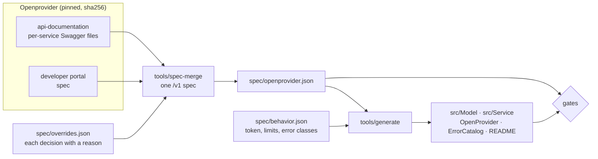

<div align="center">

# Openprovider PHP SDK

**The whole Openprovider REST API, typed, in PHP: generated from the official specification and held to it by tests.**

<!-- generated:badges -->
[](https://github.com/ashio-git/openprovider-php-sdk/actions/workflows/ci.yml)


[](LICENSE)
<!-- /generated:badges -->

[Quick start](#quick-start) ·
[Guide](#guide) ·
[API reference](#api-reference) ·
[How it is built](#how-it-is-built) ·
[Quality gates](#quality-gates) ·
[Contributing](CONTRIBUTING.md) ·
[Changelog](CHANGELOG.md)

</div>

---

Openprovider closes its `/v1beta` API to everyone on **30 June 2027**. This SDK talks to `/v1`, its
successor, and covers every operation of the current reference. You call it with PHP types: models
for requests and responses, named arguments for filters, and one exception class per kind of
failure.

Nothing in it is written from memory. The services and models are generated from a pinned copy of
Openprovider's own specification. A conformance audit runs every method against that
specification on every pull request. The badges, the counts and the API reference on this page
are generated from the code, and every example on it runs in the test suite.

```php
use Ashio\OpenProvider\Pagination\Paginator;

foreach (Paginator::all($openProvider->domain()->listDomains(...), ['status' => 'ACT']) as $domain) {
    echo $domain->domain?->name, '.', $domain->domain?->extension, ' expires ', $domain->expirationDate, PHP_EOL;
}
```

## At a glance

<!-- generated:glance -->
| | |
|---|---|
| **Operations** | 140 of the 140 in the current API reference, in 11 services |
| **Models** | 306 immutable, typed models and 4 sets of enum values |
| **Error codes** | 608, each mapped to an exception class |
| **Paged listings** | 24, 4 of them with a documented maximum page size |
| **Experimental** | 5 operations documented only by the developer portal |
| **Spec** | [`openprovider/api-documentation@e0bcf22e81`](https://github.com/openprovider/api-documentation/tree/e0bcf22e81c1247a8c6cdccf486c1673ef2aed10) and the developer portal, retrieved 2026-11-09 |
| **Tested on** | PHP 8.2, 8.3, 8.4, 8.5, each with the lowest and the highest dependencies |
<!-- /generated:glance -->

## Why this SDK

- **Complete, and proven complete.** Every operation in the API reference has exactly one method,
  and no method exists outside it. A test fails the build otherwise.
- **Correct on the wire.** Each parameter goes where the specification says: the query or the
  body, whatever the HTTP verb. Dotted names (`domain.name`) are sent as they are, lists repeat
  their key, and `false`, `0` and `''` are sent rather than dropped. Each operation has its own
  HTTP contract test.
- **Typed all the way down.** Responses arrive as immutable models with typed properties and
  nested models. Fields the API adds later are kept in `$extra` instead of being lost or
  breaking anything.
- **Errors you can act on.** Openprovider answers HTTP 500 to a failed login. The SDK ignores the
  status and classifies each of the API's documented error codes into an exception you can catch.
- **Safe by default.** Nothing is sent until you call an operation. Writes are never retried.
  An expired token triggers one new login and one repeat. Passwords and tokens never show up in
  logs, dumps or exception traces.
- **Standards, not lock-in.** Any PSR-18 HTTP client and PSR-17 factories (Guzzle by default), any
  PSR-16 cache for sharing the token between processes, and no global state.

## Contents

- [Requirements](#requirements)
- [Installation](#installation)
- [Quick start](#quick-start)
- [Guide](#guide)
  - [Calling an operation](#calling-an-operation)
  - [Responses and models](#responses-and-models)
  - [Sending data](#sending-data)
  - [Paging through listings](#paging-through-listings)
  - [Handling errors](#handling-errors)
  - [Authentication and tokens](#authentication-and-tokens)
  - [Configuration](#configuration)
  - [Retries](#retries)
  - [Using your own HTTP client](#using-your-own-http-client)
  - [Dates](#dates)
  - [Experimental operations](#experimental-operations)
  - [Leaving `/v1beta`](#leaving-v1beta)
- [API reference](#api-reference)
- [How it is built](#how-it-is-built)
- [Quality gates](#quality-gates)
- [Development](#development)
- [Security](#security)
- [Versioning and support](#versioning-and-support)
- [License](#license)

## Requirements

- PHP 8.2 or newer, with `ext-json`
- A PSR-18 HTTP client. Guzzle 7 is installed with the SDK and used unless you pass another.
- An Openprovider account. Use the [sandbox](https://api.sandbox.openprovider.nl) while you develop.

## Installation

The package is not on Packagist yet. Add the repository to your `composer.json`, then require it:

```json
{
    "repositories": [
        { "type": "vcs", "url": "https://github.com/ashio-git/openprovider-php-sdk" }
    ]
}
```

```bash
composer require ashio/openprovider-php-sdk:^3.0
```

> [!NOTE]
> Until `3.0.0` is tagged, require `dev-main` instead of `^3.0`.

## Quick start

Create the client once. No request is sent at this point: the SDK logs in when the first
operation needs a token.

```php
<?php

require __DIR__ . '/vendor/autoload.php';

use Ashio\OpenProvider\Auth\Credentials;
use Ashio\OpenProvider\Client\ApiClient;
use Ashio\OpenProvider\Client\ClientConfig;
use Ashio\OpenProvider\OpenProvider;

$openProvider = new OpenProvider(ApiClient::create(
    ClientConfig::sandbox(), // ClientConfig::production() for the live API
    new Credentials(
        getenv('OPENPROVIDER_USERNAME') ?: throw new RuntimeException('Set OPENPROVIDER_USERNAME'),
        getenv('OPENPROVIDER_PASSWORD') ?: throw new RuntimeException('Set OPENPROVIDER_PASSWORD'),
    ),
));
```

Then call any operation. Each service is one accessor on `$openProvider`, and each operation is one
method:

```php
use Ashio\OpenProvider\Model\Domain\DomainCheckDomainRequest;
use Ashio\OpenProvider\Model\Domain\DomainDomain;

$check = $openProvider->domain()->checkDomain(new DomainCheckDomainRequest(
    domains: [new DomainDomain(extension: 'com', name: 'example')],
));

foreach ($check->data->results ?? [] as $result) {
    echo $result->domain, ': ', $result->status, PHP_EOL; // example.com: active
}
```

> [!TIP]
> Every PHP example on this page is executed by the test suite against responses built from the
> specification (`tests/Readme`). An example that stops working fails the build.

## Guide

### Calling an operation

The method names and their arguments follow fixed rules, so you can read them straight off the
[API reference](#api-reference):

| In the specification | In PHP |
|---|---|
| The tag group (`DNS`, `Reseller/Customer`) | the service accessor: `dns()`, `resellerCustomer()` |
| The `operationId` (`ListZoneRecords`, `DeleteDomainMixin8`) | the method, in camelCase and without a `Mixin<n>` suffix: `listZoneRecords()`, `deleteDomain()` |
| Path parameters | the first arguments, in path order |
| The request body | the next argument: a model, such as `ZoneCreateZoneRequest` |
| Query parameters | optional named arguments, in camelCase: `domain.name` → `$domainName`, `record_name_pattern` → `$recordNamePattern` |

```php
$records = $openProvider->dns()->listZoneRecords('example.com', limit: 50, recordNamePattern: 'www*', type: 'CNAME');
```

Named arguments are checked by PHP itself. A misspelled filter is an error before anything is
sent; it is never silently ignored by the API.

### Responses and models

Every method returns an `ApiResponse`. A call that returns at all has succeeded: any code other
than `0` is thrown as an exception (see [Handling errors](#handling-errors)).

```php
$response = $openProvider->resellerCustomer()->getReseller();

$reseller = $response->data; // ResellerReseller: a typed, immutable model
echo $reseller->companyName, ' has ', $reseller->balance, ' available', PHP_EOL;

foreach ($response->warnings as $warning) { // the call worked, but the API has a remark
    error_log(sprintf('Openprovider warning %d: %s', $warning->code, $warning->desc));
}
```

Each model has `fromArray()` and `toArray()`. A model never refuses data it does not know: unknown
keys and values of an unexpected type are kept in `$extra`, so nothing the API sends is lost, and
`toArray()` gives back exactly what was received.

```php
use Ashio\OpenProvider\Model\Dns\ZoneZone;

$zone = ZoneZone::fromArray(['name' => 'example.com', 'brand_new_field' => true]);

echo $zone->name, PHP_EOL;  // example.com
print_r($zone->extra);      // ['brand_new_field' => true]
print_r($zone->toArray());  // ['name' => 'example.com', 'brand_new_field' => true]
```

Values from a fixed list stay plain strings, so a value Openprovider adds later cannot break your
code. The known values are provided as constants:

```php
use Ashio\OpenProvider\Model\ResellerCustomer\AttributesIndustry;

$industry = AttributesIndustry::WEB_HOSTING;
$known = in_array($industry, AttributesIndustry::VALUES, true); // true
```

### Sending data

Request bodies are models with named, typed constructor arguments. Absent fields are left out of
the JSON. `0`, `false` and `''` are sent as they are.

```php
use Ashio\OpenProvider\Model\Dns\ZoneCreateZoneRequest;
use Ashio\OpenProvider\Model\Dns\ZoneDomain;
use Ashio\OpenProvider\Model\Dns\ZoneRecord;

$openProvider->dns()->createZone(new ZoneCreateZoneRequest(
    domain: new ZoneDomain(extension: 'com', name: 'example'),
    type: 'master',
    records: [
        new ZoneRecord(name: '', type: 'A', value: '192.0.2.10', ttl: 900),
        new ZoneRecord(name: 'www', type: 'CNAME', value: 'example.com', ttl: 900),
    ],
));
```

### Paging through listings

`Paginator::all()` takes a list method as a first-class callable, so you write `listDomains(...)`
with three literal dots. It then fetches pages as your loop asks for them. Each page uses the
endpoint's documented maximum, which the [API reference](#api-reference) shows as *paged, max N*,
or the API's default of 100 where no maximum is documented. Fewer, larger pages keep long listings
clear of the rate limits.

```php
use Ashio\OpenProvider\Pagination\Paginator;

$expiring = [];
foreach (Paginator::all($openProvider->domain()->listDomains(...), ['status' => 'ACT']) as $domain) {
    if ($domain->expirationDate !== null && $domain->expirationDate < '2027-01-01') {
        $expiring[] = $domain->domain?->name . '.' . $domain->domain?->extension;
    }
}
```

The second argument carries the method's other arguments, which are sent with every page.
`pageSize:` lowers the page size, but never raises it above the endpoint's maximum. A method that is
not a paged listing is refused before anything is sent.

### Handling errors

Every exception the SDK throws implements `OpenProviderException`. API errors are classified by
the API's own error code, never by the HTTP status:

<!-- generated:errors -->
| Exception | Thrown when | API codes |
|---|---|---|
| `AuthenticationException` | The login was refused or the token is not accepted (after one automatic re-login on code 196). | 5 |
| `RateLimitedException` | A rate limit or a temporary block. Never retried automatically. | 2 |
| `MaintenanceException` | The API is in maintenance. Reads may be retried if you opt in. | 5 |
| `NotFoundException` | The object does not exist. | 13 |
| `ValidationException` | The API refused the input. | 226 |
| `ApiException` | Any other API error; the base class of the five above. | 357 |
| `TransportException` | The HTTP request itself failed (network, DNS, TLS, timeout). | — |
| `UnexpectedResponseException` | The API answered with something that is not a JSON envelope, or data of another type than the spec declares. | — |
| `InvalidArgumentException` | An argument the spec does not allow, caught before anything is sent. | — |
<!-- /generated:errors -->

```php
use Ashio\OpenProvider\Exception\ErrorCatalog;
use Ashio\OpenProvider\Exception\NotFoundException;
use Ashio\OpenProvider\Exception\OpenProviderException;
use Ashio\OpenProvider\Exception\ValidationException;

try {
    $zone = $openProvider->dns()->getZone('example.com')->data;
} catch (NotFoundException) {
    $zone = null;
} catch (ValidationException $e) {
    // The API's code and message, plus the documented fix when there is one.
    error_log(sprintf('%d %s. %s', $e->apiCode, $e->desc, ErrorCatalog::resolution($e->apiCode) ?? ''));
    throw $e;
} catch (OpenProviderException $e) {
    throw $e; // any other API error, a network failure or an unexpected answer
}
```

An `ApiException` carries everything from the envelope: `apiCode`, `httpStatus`, `desc`, `data`,
`warnings` and `maintenance`. `ErrorCatalog::describe()` and `ErrorCatalog::resolution()` give the
documented text for any code.

### Authentication and tokens

- **Lazy login.** The first operation that needs a token logs in. Operations the API serves
  without a token, such as the login itself and the reseller signup, are sent without one.
- **One token, reused.** The token is kept and reused until shortly before it expires, then
  replaced. By default it lives in memory, for the life of the client.
- **Expiry handled once.** On code 196 (token expired or invalid), the client logs in again and
  repeats the call once. This also applies to writes, because the API refused the call before
  running it. Any other failure of a write is never repeated.

To share the token between processes or requests (for example PHP-FPM workers), give the client
any PSR-16 cache:

```php
use Ashio\OpenProvider\Auth\Psr16TokenStore;
use Ashio\OpenProvider\Client\ApiClient;
use Ashio\OpenProvider\Client\ClientConfig;

$client = ApiClient::create(ClientConfig::production(), $credentials, tokenStore: new Psr16TokenStore($cache));
```

Tokens are stored per environment and username, and are masked wherever they could be printed.

### Configuration

`ClientConfig` holds the connection settings and no credentials, so it is safe to log.

| Option | Default | |
|---|---|---|
| `environment` | (required) | `Environment::Production` (`api.openprovider.eu`) or `Environment::Sandbox` (`api.sandbox.openprovider.nl`). An unknown name throws instead of falling back to production. |
| `basePath` | `/v1` | `/v1beta` still works until 30 June 2027. |
| `timeout` | `60.0` | Seconds for a whole request. |
| `connectTimeout` | `10.0` | Seconds to connect. |
| `userAgent` | `ashio-openprovider-php/<version>` | One line, never empty. |
| `ip` | none | Sent with the login, if your account restricts logins by IP. |
| `getRetry` | no retries | See [Retries](#retries). |

```php
use Ashio\OpenProvider\Client\ClientConfig;
use Ashio\OpenProvider\Client\Environment;
use Ashio\OpenProvider\Client\RetryPolicy;

$config = new ClientConfig(
    Environment::from(getenv('OPENPROVIDER_ENV') ?: 'sandbox'),
    timeout: 30.0,
    connectTimeout: 5.0,
    getRetry: new RetryPolicy(maxRetries: 2),
);
```

### Retries

Retries are off by default, and only reads (GET) can be retried. A read is retried after a
network failure, an HTTP 5xx answer that is not JSON, or a maintenance code. It waits 250 ms,
1 s and 4 s before the first, second and third retry, then 4 s for any further one; pass
`delaysMs:` to change that.

Writes are sent exactly once. The API documents no idempotency, and it blocks identical writes
for minutes, so a blind retry could register a domain twice or lock you out. Rate limits and
blocks are never retried either. Back off and try later.

### Using your own HTTP client

Any PSR-18 client works, with PSR-17 factories if you do not use Guzzle's:

```php
use Ashio\OpenProvider\Client\ApiClient;

$client = ApiClient::create($config, $credentials, httpClient: $httpClient);
```

The SDK never discovers implementations on its own, and it keeps no global state. Two clients with
different accounts or environments can run side by side.

### Dates

The API sends dates as strings without an offset, in the `Europe/Amsterdam` time zone. Models
keep them exactly as received, so nothing is converted behind your back and `toArray()` returns
the original. To work with them as dates, convert them where you need to:

```php
$domain = $openProvider->domain()->getDomain(123)->data;

$expires = DateTimeImmutable::createFromFormat(
    'Y-m-d H:i:s',
    (string) $domain->expirationDate,
    new DateTimeZone('Europe/Amsterdam'),
);
```

### Experimental operations

A few operations are documented only on the developer portal and not in Openprovider's published
specification: Mailcow white-label and the reseller signup. They are marked `@experimental` in
their docblocks and in the [API reference](#api-reference). They work today, but Openprovider may
change them without notice.

```php
use Ashio\OpenProvider\Model\Portal\McWhiteLabelWhiteLabelRetrieveWhiteLabelDomainRequest;

$whiteLabel = $openProvider->mailcow()->retrieveWhiteLabelDomain(new McWhiteLabelWhiteLabelRetrieveWhiteLabelDomainRequest());
```

### Leaving `/v1beta`

The SDK uses `/v1`, which behaves the same as `/v1beta`. If you need a transition period, the old
path is one setting away:

```php
use Ashio\OpenProvider\Client\ClientConfig;
use Ashio\OpenProvider\Client\Environment;

$legacy = new ClientConfig(Environment::Production, basePath: '/v1beta'); // until 30 June 2027
```

## API reference

Every service and operation, generated from the code. Open a service to see its methods.
Operations marked *paged* work with `Paginator::all()`; *experimental* ones are
[documented only by the portal](#experimental-operations). The full parameter list of each method is
in its docblock, which your IDE shows.

<!-- generated:services -->
<details>
<summary><code>$openProvider->auth()</code> · Auth · 3 operations</summary>

| Method | Endpoint | Summary |
|---|---|---|
| `login()` | `POST /auth/login` | Login with username and password |
| `createResellerPublic()` | `POST /resellers/signup` | Sign up a new reseller (public) <sub>experimental</sub> |
| `generateLoginURL()` | `POST /spam-expert/generate-login-url` | Generate login url |

</details>

<details>
<summary><code>$openProvider->billing()</code> · Billing · 3 operations</summary>

| Method | Endpoint | Summary |
|---|---|---|
| `listInvoices()` | `GET /invoices` | List invoices <sub>paged</sub> |
| `listPayments()` | `GET /payments` | List payments <sub>paged</sub> |
| `listTransactions()` | `GET /transactions` | List transactions <sub>paged</sub> |

</details>

<details>
<summary><code>$openProvider->dns()</code> · DNS · 21 operations</summary>

| Method | Endpoint | Summary |
|---|---|---|
| `createToken()` | `POST /dns/domain-token` | Create token |
| `listNameservers()` | `GET /dns/nameservers` | List nameservers <sub>paged</sub> |
| `createNameserver()` | `POST /dns/nameservers` | Create nameserver |
| `listGroups()` | `GET /dns/nameservers/groups` | List groups <sub>paged</sub> |
| `createGroup()` | `POST /dns/nameservers/groups` | Create group |
| `getGroup()` | `GET /dns/nameservers/groups/{ns_group}` | Get group |
| `updateGroup()` | `PUT /dns/nameservers/groups/{ns_group}` | Update group |
| `deleteGroup()` | `DELETE /dns/nameservers/groups/{ns_group}` | Delete group |
| `getNameserver()` | `GET /dns/nameservers/{name}` | Get nameserver |
| `updateNameserver()` | `PUT /dns/nameservers/{name}` | Update nameserver |
| `deleteNameserver()` | `DELETE /dns/nameservers/{name}` | Delete nameserver |
| `listTemplates()` | `GET /dns/templates` | List templates <sub>paged</sub> |
| `createTemplate()` | `POST /dns/templates` | Create template |
| `getTemplate()` | `GET /dns/templates/{id}` | Get template |
| `deleteTemplate()` | `DELETE /dns/templates/{id}` | Delete template |
| `listZones()` | `GET /dns/zones` | List zones <sub>paged, max 500</sub> |
| `createZone()` | `POST /dns/zones` | Create zone |
| `getZone()` | `GET /dns/zones/{name}` | Get zone |
| `updateZone()` | `PUT /dns/zones/{name}` | Update zone |
| `deleteZone()` | `DELETE /dns/zones/{name}` | Delete zone |
| `listZoneRecords()` | `GET /dns/zones/{name}/records` | List zone records <sub>paged, max 500</sub> |

</details>

<details>
<summary><code>$openProvider->domain()</code> · Domain · 21 operations</summary>

| Method | Endpoint | Summary |
|---|---|---|
| `listDomains()` | `GET /domains` | List domains <sub>paged, max 1000</sub> |
| `createDomain()` | `POST /domains` | Create domain |
| `getAdditionalData()` | `GET /domains/additional-data` | Get additional data |
| `getData()` | `GET /domains/additional-data/customers` | Get data |
| `checkDomain()` | `POST /domains/check` | Check domain |
| `getPrice()` | `GET /domains/prices` | Get price |
| `suggestNameDomain()` | `POST /domains/suggest-name` | Suggest name domain |
| `tradeDomain()` | `POST /domains/trade` | Trade domain |
| `transferDomain()` | `POST /domains/transfer` | Transfer domain |
| `getDomain()` | `GET /domains/{id}` | Get domain |
| `updateDomain()` | `PUT /domains/{id}` | Update domain |
| `deleteDomain()` | `DELETE /domains/{id}` | Delete domain |
| `getAuthCode()` | `GET /domains/{id}/authcode` | Get auth code |
| `resetAuthCode()` | `POST /domains/{id}/authcode/reset` | Reset auth code |
| `tryAgainLastOperation()` | `POST /domains/{id}/last-operation/restart` | Try again last operation |
| `renewDomain()` | `POST /domains/{id}/renew` | Renew domain |
| `restoreDomain()` | `POST /domains/{id}/restore` | Restore domain |
| `approveTransfer()` | `POST /domains/{id}/transfer/approve` | Approve transfer |
| `sendFoa1()` | `POST /domains/{id}/transfer/send-foa1` | Send foa1 |
| `listTlds()` | `GET /tlds` | List tlds <sub>paged</sub> |
| `getTld()` | `GET /tlds/{name}` | Get tld |

</details>

<details>
<summary><code>$openProvider->easyDmarc()</code> · EasyDmarc · 6 operations</summary>

| Method | Endpoint | Summary |
|---|---|---|
| `getEasyDmarc()` | `GET /easydmarcs` | Get easy dmarc |
| `createEasyDmarc()` | `POST /easydmarcs` | Create easy dmarc |
| `listEasyDmarc()` | `GET /easydmarcs/list` | List easy dmarc <sub>paged</sub> |
| `deleteEasyDmarc()` | `DELETE /easydmarcs/{id}` | Delete easy dmarc |
| `retryEasyDmarc()` | `POST /easydmarcs/{id}/retry` | Retry easy dmarc |
| `getEasyDmarcSso()` | `GET /easydmarcs/{id}/sso` | Get easy dmarc sso |

</details>

<details>
<summary><code>$openProvider->emailTemplate()</code> · Email template · 4 operations</summary>

| Method | Endpoint | Summary |
|---|---|---|
| `listEmails()` | `GET /emails` | List emails <sub>paged</sub> |
| `createEmail()` | `POST /emails` | Create email |
| `updateEmail()` | `PUT /emails/{id}` | Update email |
| `deleteEmail()` | `DELETE /emails/{id}` | Delete email |

</details>

<details>
<summary><code>$openProvider->license()</code> · License · 15 operations</summary>

| Method | Endpoint | Summary |
|---|---|---|
| `listLicensesWithPriceVersion()` | `GET /licenses` | List licenses with price version <sub>paged</sub> |
| `resetHwid()` | `POST /licenses/hwids/reset/{product}/{key_id}` | Reset hwid |
| `listItems()` | `GET /licenses/items` | List items <sub>paged</sub> |
| `listPleskLicenses()` | `GET /licenses/plesk` | List plesk licenses <sub>paged</sub> |
| `createPleskLicense()` | `POST /licenses/plesk` | Create plesk license |
| `getPleskKey()` | `GET /licenses/plesk/key/{key_id}` | Get plesk key |
| `getPleskLicense()` | `GET /licenses/plesk/{key_id}` | Get plesk license |
| `updatePleskLicense()` | `PUT /licenses/plesk/{key_id}` | Update plesk license |
| `deletePleskLicense()` | `DELETE /licenses/plesk/{key_id}` | Delete plesk license |
| `listVirtuozzoLicenses()` | `GET /licenses/virtuozzo` | List virtuozzo licenses <sub>paged</sub> |
| `createVirtuozzoLicense()` | `POST /licenses/virtuozzo` | Create virtuozzo license |
| `getVirtuozzoLicense()` | `GET /licenses/virtuozzo/{key_id}` | Get virtuozzo license |
| `updateVirtuozzoLicense()` | `PUT /licenses/virtuozzo/{key_id}` | Update virtuozzo license |
| `deleteVirtuozzoLicense()` | `DELETE /licenses/virtuozzo/{key_id}` | Delete virtuozzo license |
| `getVirtuozzoKey()` | `GET /licenses/virtuozzo/{key_id}/key` | Get virtuozzo key |

</details>

<details>
<summary><code>$openProvider->resellerCustomer()</code> · Reseller/Customer · 20 operations</summary>

| Method | Endpoint | Summary |
|---|---|---|
| `listContacts()` | `GET /contacts` | List contacts <sub>paged</sub> |
| `createContact()` | `POST /contacts` | Create contact |
| `getContact()` | `GET /contacts/{id}` | Get contact |
| `updateContact()` | `PUT /contacts/{id}` | Update contact |
| `deleteContact()` | `DELETE /contacts/{id}` | Delete contact |
| `listCustomers()` | `GET /customers` | List customers <sub>paged</sub> |
| `createCustomer()` | `POST /customers` | Create customer |
| `listDomainEmailVerifications()` | `GET /customers/verifications/emails/domains` | List domain email verifications <sub>paged</sub> |
| `restartEmailVerification()` | `POST /customers/verifications/emails/restart` | Restart email verification |
| `startEmailVerification()` | `POST /customers/verifications/emails/start` | Start email verification |
| `getCustomer()` | `GET /customers/{handle}` | Get customer |
| `updateCustomer()` | `PUT /customers/{handle}` | Update customer |
| `deleteCustomer()` | `DELETE /customers/{handle}` | Delete customer |
| `getReseller()` | `GET /resellers` | Get reseller |
| `getSettings()` | `GET /resellers/settings` | Get settings |
| `getStatistics()` | `GET /resellers/statistics` | Get statistics |
| `updateReseller()` | `PUT /resellers/{id}` | Update reseller |
| `listTags()` | `GET /tags` | List tags |
| `createTag()` | `POST /tags` | Create tag |
| `deleteTag()` | `DELETE /tags` | Delete tag |

</details>

<details>
<summary><code>$openProvider->spamExperts()</code> · Spam Experts · 4 operations</summary>

| Method | Endpoint | Summary |
|---|---|---|
| `createDomain()` | `POST /spam-expert/domains` | Create domain |
| `getDomain()` | `GET /spam-expert/domains/{domain_name}` | Get domain |
| `updateDomain()` | `PUT /spam-expert/domains/{domain_name}` | Update domain |
| `deleteDomain()` | `DELETE /spam-expert/domains/{domain_name}` | Delete domain |

</details>

<details>
<summary><code>$openProvider->ssl()</code> · SSL · 15 operations</summary>

| Method | Endpoint | Summary |
|---|---|---|
| `listApproverEmails()` | `GET /ssl/approver-emails` | List approver emails |
| `createCsr()` | `POST /ssl/csr` | Create csr |
| `decodeCsr()` | `POST /ssl/csr/decode` | Decode csr |
| `listOrders()` | `GET /ssl/orders` | List orders <sub>paged, max 1000</sub> |
| `createOrder()` | `POST /ssl/orders` | Create order |
| `getOrder()` | `GET /ssl/orders/{id}` | Get order |
| `updateOrder()` | `PUT /ssl/orders/{id}` | Update order |
| `updateApproverEmailAddress()` | `PUT /ssl/orders/{id}/approver-email` | Update approver email address |
| `resendApproverEmail()` | `POST /ssl/orders/{id}/approver-email/resend` | Resend approver email |
| `cancelOrder()` | `POST /ssl/orders/{id}/cancel` | Cancel order |
| `createOtpToken()` | `POST /ssl/orders/{id}/otp-tokens` | Create otp token |
| `reissueOrder()` | `POST /ssl/orders/{id}/reissue` | Reissue order |
| `renewOrder()` | `POST /ssl/orders/{id}/renew` | Renew order |
| `listProducts()` | `GET /ssl/products` | List products <sub>paged</sub> |
| `getProduct()` | `GET /ssl/products/{id}` | Get product |

</details>

<details>
<summary><code>$openProvider->mailcow()</code> · Mailcow · 28 operations</summary>

| Method | Endpoint | Summary |
|---|---|---|
| `listAlias()` | `GET /mailcow/alias` | List alias <sub>paged</sub> |
| `addAlias()` | `POST /mailcow/alias` | Add alias |
| `editAlias()` | `POST /mailcow/alias/edit/{id}` | Edit alias |
| `getAlias()` | `GET /mailcow/alias/{id}` | Get alias |
| `deleteAlias()` | `DELETE /mailcow/alias/{id}` | Delete alias |
| `getMailCowDkim()` | `GET /mailcow/dkim` | Get Dkim records for the domain. |
| `createMailCowDkim()` | `POST /mailcow/dkim` | Get Dkim records for the domain. |
| `deleteMailCowDkim()` | `DELETE /mailcow/dkim` | Delete Dkim records for a domain. |
| `addDomain()` | `POST /mailcow/domains` | Add domain |
| `deleteMailcowDomain()` | `DELETE /mailcow/domains` | Delete domain |
| `listDomain()` | `GET /mailcow/domains/list` | List domain <sub>paged</sub> |
| `editMailbox()` | `POST /mailcow/mailbox/edit` | Edit mailbox |
| `modifyMailboxName()` | `POST /mailcow/mailbox/name/modify` | Modify mailbox name |
| `increaseMailboxQuota()` | `POST /mailcow/mailbox/quota/increase` | Increase mailbox quota |
| `listOrder()` | `GET /mailcow/orders` | List order <sub>paged</sub> |
| `createMailcowOrder()` | `POST /mailcow/orders` | Create order |
| `assignMailbox()` | `POST /mailcow/orders/assign` | Assign mailbox |
| `retainMailbox()` | `POST /mailcow/orders/retain` | Retain mailbox |
| `getMailcowOrder()` | `GET /mailcow/orders/{id}` | Get order |
| `deleteOrder()` | `DELETE /mailcow/orders/{id}` | Delete order |
| `getMailboxPassword()` | `GET /mailcow/orders/{id}/password` | Get mailbox password |
| `getMailcowStatistics()` | `GET /mailcow/statistics` | Get mailcow statistics |
| `getTimeLimitedAlias()` | `GET /mailcow/time-limited/alias` | Get time limited alias |
| `addTimeLimitedAlias()` | `POST /mailcow/time-limted/alias` | Add time limited alias |
| `retrieveWhiteLabelDomain()` | `POST /mailcow/white-labels/domain` | Retrieve white label domain <sub>experimental</sub> |
| `upsertWhiteLabelDomain()` | `POST /mailcow/white-labels/domain/upsert` | Upsert white label domain <sub>experimental</sub> |
| `retrieveWhiteLabelLogo()` | `POST /mailcow/white-labels/logo` | Retrieve white label logo <sub>experimental</sub> |
| `modifyWhiteLabelLogo()` | `POST /mailcow/white-labels/logo/modify` | Modify white label logo <sub>experimental</sub> |

</details>
<!-- /generated:services -->

## How it is built



1. **Sources.** `tools/spec-sync` downloads Openprovider's per-service Swagger files and the
   developer portal's spec, and pins their bytes in `spec/SHA256SUMS`. A weekly job opens an
   issue when upstream changes.
2. **Merge.** `tools/spec-merge` builds one `/v1` spec with the portal's operations and the union
   of both sources' fields. A conflict between them must be settled in `spec/overrides.json`, with
   a reason. The merge is reproducible to the byte.
3. **Generate.** `tools/generate` writes the models, the services, the operation registry, the
   error catalog and the generated parts of this README. The generated code carries an
   `@generated` header, and CI fails if regenerating it changes a single byte.
4. **Hand-written core.** The transport, authentication, request encoding, responses, exceptions
   and pagination live outside the generated folders, in `src/Client`, `src/Auth`, `src/Http`,
   `src/Response`, `src/Exception` and `src/Pagination`.

## Quality gates

Each gate runs in CI on every pull request and can fail it.

<!-- generated:gates -->
| Gate | What it guarantees | How |
|---|---|---|
| **S1** registry | Every operation in the spec has exactly one method, and no public method is anything else | `tests/Service/OperationRegistryTest.php` |
| **S2** conformance | No divergence between what each method sends and reads and what the spec declares; the audit is itself tested against bugs planted from 2.x | `composer conformance` |
| | One HTTP contract test for each of the 140 operations: method, path, query, body, token and response mapping | `tests/Service/OperationContractTest.php` |
| **S3** models | Each of the 306 models round-trips seeded random payloads built from its schema, plus edge cases | `tests/Model/ModelRoundTripTest.php` |
| **S4** tests | Line coverage of at least 95% and a mutation score (MSI) of at least 85% | `composer test:coverage`, Infection |
| **S5** types | PHPStan at level max and Psalm at level 1, both with no baseline | `composer quality` |
| **S6** compatibility | PHP 8.2, 8.3, 8.4, 8.5, each with the lowest and the highest dependencies | CI matrix |
| **S7** reality | The SDK against the real sandbox | `composer smoke`, run manually |
| **S8** honesty | The badges, the counts, the API reference and the error and gate tables of this README are generated, and every example in it is executed | `composer spec:verify`, `tests/Readme` |
<!-- /generated:gates -->

PHPUnit itself fails on any warning, notice or deprecation.

## Development

```bash
composer quality          # php-cs-fixer, PHPStan, Psalm, PHPUnit: all must pass
composer spec:verify      # pinned inputs, reproducible merge, every generated file up to date
composer conformance      # the S2 audit
composer test:coverage    # PHPUnit with coverage, then the 95% line gate
composer smoke            # the sandbox suite; needs OPENPROVIDER_SANDBOX_USERNAME and _PASSWORD
```

Never edit generated code by hand (`src/Model`, `src/Service`, `src/OpenProvider.php`,
`src/Exception/ErrorCatalog.php`, or the generated regions of this README): change the inputs and
run `php tools/generate errors models operations readme`. [CONTRIBUTING.md](CONTRIBUTING.md) has
the workflow, and [AGENTS.md](AGENTS.md) has the contract for coding agents.

## Security

- Passwords and tokens are held in a `Secret` that prints as `********` in strings, `var_dump`,
  `print_r`, `var_export`, JSON and exception traces, and cannot be serialized. Constructor
  arguments that carry them are marked `#[\SensitiveParameter]`.
- Every request uses HTTPS. The environment is an enum, so a typo cannot fall back to production.
- To report a vulnerability, use a private
  [security advisory](https://github.com/ashio-git/openprovider-php-sdk/security/advisories/new),
  not a public issue. See [SECURITY.md](SECURITY.md).

## Versioning and support

- The SDK follows [Semantic Versioning](https://semver.org). Generated code changes only through a
  pinned spec update, and each update is recorded in the [changelog](CHANGELOG.md).
- 3.0 is a full rewrite with a new namespace (`Ashio\OpenProvider\`). It replaces 2.x and offers
  no compatibility layer.
- Each PHP version is supported while it is tested in CI; the badge at the top shows the range.
- Openprovider's `/v1beta` closes on 30 June 2027. The SDK has used `/v1` since 3.0.

## License

MIT © Marco Dantas. See [LICENSE](LICENSE).

Openprovider is a trademark of Openprovider B.V. This project is independent and is not
affiliated with or endorsed by Openprovider.
